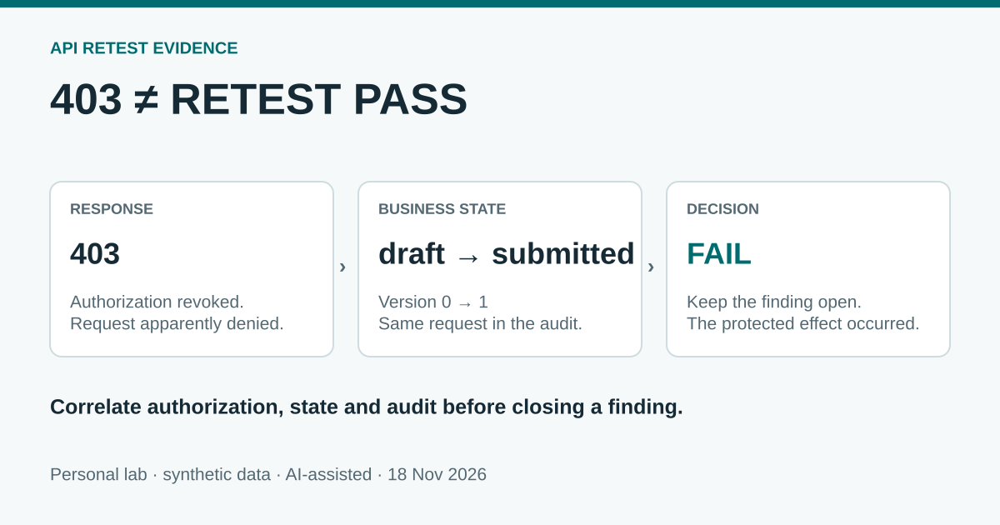

**Personal portfolio · API Retest Evidence uses synthetic data and was developed with AI assistance on 18 November 2026**

# Application Security · Web & API

Authorization, business logic and evidence-based retesting. Based in Rabat, Morocco, with professional experience in Germany. Findings communicated in English, French and German.

> “I would recommend him without a doubt for any Pen Tester or Consultant roles.”

[Corentin Cleuziat, former direct manager · LinkedIn recommendation, 12 March 2024](https://www.linkedin.com/in/amineaboubzou/details/recommendations/)

## API Retest Evidence

### 1. HTTP + SQLite: observe the protected effect

In case **H03**, permission is revoked and the local HTTP service returns `403`. SQLite still records `draft v0 → submitted v1`, with a correlated `unauthorized_commit` audit event. **Decision: FAIL. Keep the finding open.**

In the corrected case **H02**, the response is also `403`, while the record remains `draft v0` and the audit records the denial. **Decision: PASS for this observed attempt.** The experiment uses real localhost HTTP requests and a persistent SQLite file, with synthetic identities and data.

**Reproduced locally and in [public CI on Ubuntu / Python 3.12](https://github.com/0xSecBadger/Profile/actions/runs/44371823169):** 14 cases and 45 HTTP requests, with 12 PASS and 2 deliberate FAIL outcomes. The 10 regression tests and 21 separately authored contract tests pass. [Audit findings and limits](api-retest-evidence/http-retest/audit/AUDIT.md).

**Inspect or reproduce:** [HTTP results](api-retest-evidence/http-retest/results/HTTP-RESULTS.md) · [Request/response and SQL evidence](api-retest-evidence/http-retest/results/http-report.json) · [Service and transaction boundary](api-retest-evidence/http-retest/server.py) · [Reproduction commands and limits](api-retest-evidence/http-retest/README.md)

### 2. Local SLMs: evaluate verdicts on a separate corpus

A separate **28-case Python in-memory corpus** tests authorization, state changes, audit correlation and insufficient evidence. Two local Qwen3 models were evaluated once against its deterministic verdicts. The recorded protocol retains their incorrect PASS verdicts, invalid responses and output-budget limits.

**The models were not rerun on the HTTP/SQLite cases.**

[SLM protocol and raw outputs](api-retest-evidence/evaluation/README.md) · [28-case verifier](api-retest-evidence/src/retest_lab/verifier.py) · [28-case in-memory / SLM report — EN / FR / DE](api-retest-evidence/output/pdf/api_retest_evidence_en_fr_de.pdf)

Français · Deux preuves distinctes

**Laboratoire personnel · données synthétiques · développé avec assistance IA · 18 novembre 2026**

**HTTP et SQLite.** Dans le cas H03, le droit est révoqué et la réponse HTTP vaut `403`. La base SQLite passe néanmoins de `draft v0` à `submitted v1`, avec un événement `unauthorized_commit` corrélé. Le verdict est **FAIL**. Dans le cas corrigé H02, la même réponse `403` accompagne un état inchangé et un refus journalisé : **PASS pour cette tentative observée**. Les échanges HTTP sont réels, sur la machine locale, avec des identités et données synthétiques.

**Évaluation SLM séparée.** Deux modèles Qwen3 locaux ont été évalués sur un autre corpus de **28 cas Python en mémoire**. Le protocole, les réponses complètes et les limites sont consultables. **Les modèles n'ont pas été réévalués sur les cas HTTP/SQLite.**

Deutsch · Zwei getrennte Nachweise

**Persönliches Testlabor · synthetische Daten · mit KI-Unterstützung entwickelt · 18. November 2026**

**HTTP und SQLite.** Im Fall H03 wurde die Berechtigung entzogen, und die HTTP-Antwort lautet `403`. Der SQLite-Datensatz wechselt dennoch von `draft v0` zu `submitted v1`; ein korreliertes Audit-Ereignis lautet `unauthorized_commit`. Das Urteil ist **FAIL**. Im korrigierten Fall H02 bleiben bei derselben Antwort `403` der Datensatz unverändert und die Ablehnung protokolliert: **PASS für diesen beobachteten Versuch**. Es werden echte lokale HTTP-Anfragen mit synthetischen Identitäten und Daten verwendet.

**Getrennte SLM-Auswertung.** Zwei lokale Qwen3-Modelle wurden anhand eines anderen Korpus mit **28 Python-Fällen im Arbeitsspeicher** ausgewertet. Protokoll, vollständige Antworten und Grenzen sind einsehbar. **Die Modelle wurden nicht erneut anhand der HTTP-/SQLite-Fälle ausgewertet.**

## CVE Exchange

**Public repository since January 2026 · Python terminal dashboard**

Review CVE information from sources such as NVD, CISA KEV and FIRST EPSS, inspect the factors behind a weighted priority score, and maintain filtered watchlists.

[Source code and usage](https://github.com/0xSecBadger/cve_exchange) · [Scoring implementation](https://github.com/0xSecBadger/cve_exchange/blob/main/src/cve_exchange/score.py)

View the terminal interface

[LinkedIn](https://www.linkedin.com/in/amineaboubzou/)
