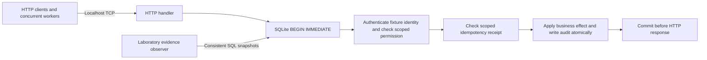

# HTTP Retest Evidence

**Authorization, idempotency and persistent business effects · Personal project · 18 November 2026 · Developed with AI coding assistance**

An actual HTTP response can say `403` while the database contains an unauthorized change. This laboratory makes that failure visible, then tests a corrected implementation through real localhost HTTP requests and SQLite observations.

The recorded run exercises **14 cases through 45 HTTP requests**. The corrected implementation passes 12 cases. Two deliberately vulnerable cases fail the security contract as expected: an unauthorized commit hidden behind `403`, and an idempotency cache served after permission revocation. All 14 expected fixture outcomes are verified. Ten regression test methods also pass.

## Inspect or reproduce

Use Python 3.12 or newer. The service, client and tests use the standard library only.

```sh
cd api-retest-evidence/http-retest
python3 -m unittest -v test_http.py
python3 run_demo.py --output results
```

Each command starts its own server bound to `127.0.0.1` on an ephemeral port, creates fresh temporary SQLite databases, issues HTTP requests and closes the servers. The client explicitly disables proxy use. Existing databases and external services are not used.

- [Readable results](results/HTTP-RESULTS.md)
- [Full request/response and SQL evidence](results/http-report.json)
- [Service and transaction boundary](server.py)
- [HTTP scenario runner](run_demo.py)
- [Regression tests](test_http.py)
- [Separately authored adversarial audit](audit/)

The JSON report includes complete SQL snapshots before and after each case, HTTP status and response bodies, request correlation identifiers, expected and observed verdicts, individual security assertions and source hashes. Concurrent winners and wall-clock execution metadata can vary between runs; the asserted contracts remain the same.

## The decisive case

After the owner revokes Alice's submission permission, both implementations return `403` for the same attempted operation.

| Evidence | Vulnerable H03 | Corrected H02 |
|---|---|---|
| HTTP response | `403 submit permission denied` | `403 submit permission denied` |
| Expense status | `draft → submitted` | `draft → draft` |
| Business version | `0 → 1` | `0 → 0` |
| Correlated audit | `unauthorized_commit` | `authorization_denied` |
| Retest decision | **FAIL** | **PASS for this attempt** |

The verdict comes from the observed contract. The HTTP response alone cannot distinguish these two outcomes.

## Architecture and decisions



**Keep authorization, cache lookup and mutation in one transaction.** The corrected handler acquires a SQLite write transaction before checking the current grant. Permission is checked before returning a cached idempotency result. Revocation uses the same transaction mechanism, so each operation has an ordered decision point within this local database.

**Scope a receipt to a command.** Its primary key is `(tenant, actor, expense, action, idempotency_key)`. Reusing a key for another resource or principal does not transfer authority or replay another command. An authorized repeat returns `200` with the original request identifier and does not increment the business version. A new key against an already submitted expense returns `409`.

**Give each HTTP attempt a fresh correlation identifier.** The request ledger rejects a reused `X-Request-ID` for the same authenticated `(tenant, actor)` with `409`, before a new effect or audit entry. An idempotent retry therefore uses the same idempotency key and a new request identifier. The request ledger is a correlation convention for this demonstration, not an authentication mechanism.

**Record identity scope separately from target scope.** An audit row contains the authenticated principal's tenant as well as the target tenant, actor, resource, action, request identifier, outcome and before/after business versions. A cross-tenant refusal remains attributable even when actors have the same name in different tenants.

**Commit state, receipt and audit together.** A successful mutation and its evidence are in one SQLite transaction. HTTP responses are sent after the transaction commits. A laboratory observer takes a consistent read snapshot after the case's requests have completed.

**Bound idle reads.** Each connection has a two-second idle socket timeout, including incomplete request bodies. This keeps the tested shutdown case from waiting indefinitely for an idle client. It is not a total request deadline or a general denial-of-service defense.

## Tested contracts

- Authorized submission remains functional, so a fix that denies everything is caught.
- Revocation blocks a fresh submission without changing the protected state.
- Revocation also blocks a previously successful idempotent replay.
- Another tenant, a view-only delegate, an unknown identity and a non-owner attempting revocation cannot obtain the protected effect.
- Twelve simultaneous requests with the same key produce one `201`, eleven authorized replays and one business-state transition.
- Twelve simultaneous requests with different keys produce one `201`, eleven conflicts and one transition.
- Closing and reopening the HTTP server against the same SQLite file preserves the expense, receipt and original request. This is a graceful restart test.
- A repeated request identifier does not create an additional attempt or effect.

The intentionally vulnerable mode is confined to the same local laboratory. It serves a cached receipt before reauthorization and commits a draft expense before returning a denial. These behaviors provide explicit failure controls for the retest evidence.

## Scope and provenance

The fixture strings `lab-alice-token`, `lab-bob-token`, `lab-owner-token` and `lab-beta-token` identify synthetic principals. They are not production credentials. Their static lookup deliberately keeps authentication mechanics outside this exercise; it does not implement OAuth, OpenID Connect or JWT validation.

The server runs on one host, uses threads for requests and serializes writes through SQLite. The concurrent tests exercise local request overlap. They do not establish distributed consistency, replica behavior, external side-effect atomicity, transaction races in another database or crash/power-loss durability. A graceful restart is narrower than recovery after a crash.

The observer and database are trusted laboratory components. Audit rows are correlated database evidence, not signed records from an independently protected collector. The service has no TLS, rate limiting or production deployment configuration.

This extension was created for the personal portfolio on **18 November 2026 with AI coding assistance**. It contains no employer or client data and is not attributed to an employer. The separately published 28-case local SLM evaluation remains a different experiment; the models have not been rerun on these HTTP cases.
